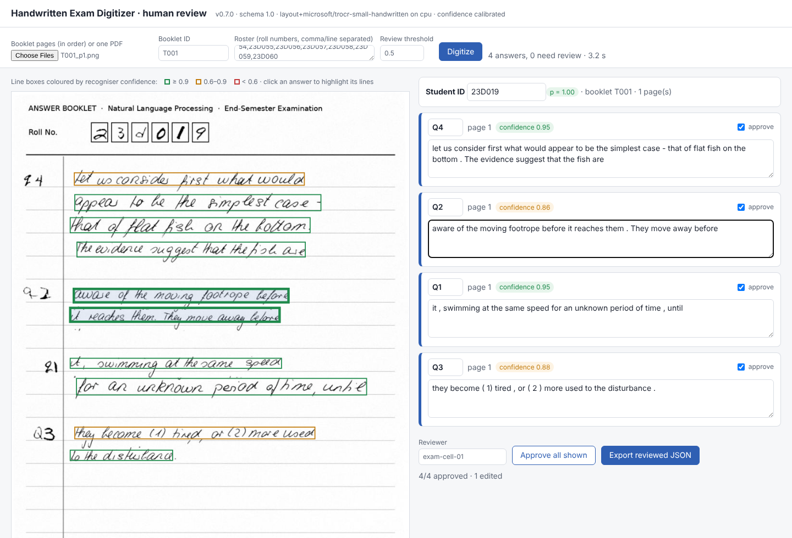
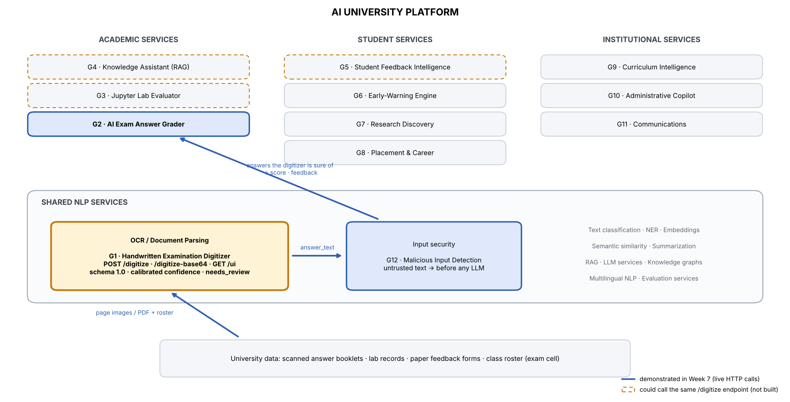

# Handwritten Examination Digitizer — Group 1 (NLP Course Project 2026)

**Asset:** scanned handwritten answer booklet → question-wise answer text (JSON) with a calibrated confidence and a
`needs_review` flag, plus a browser page on which a human checks and corrects what was read. A shared OCR service of the
*AI University* platform; its output is the input of Group 2's AI Exam Grader.

```
page images / PDF ──► preprocessing ──► layout analysis ──► TrOCR (lines) + glyph CNN (roll no., Q-numbers)
                      normalise·deskew   lines · margin marks   constrained decoding · roster check
                   ──► question segmentation ──► calibrated confidence ──► JSON (schema 1.0)
platform flow:  scan ─► G1 /digitize ─► human review page (low confidence) ─► G2 grader ─► marksheet
                                                                              └─ G2 screens every answer with G12 PromptGuard first
```

Team: J001, J002, J004, J005, J006 · Asset version 0.7.0 · Output schema 1.0 · integrated with Group 2's grader (Week 8)

## The "reusable asset" test — what another group needs tomorrow

| | |
|---|---|
| **Component** | Handwritten Examination Digitizer |
| **Input** | one booklet = page images (PNG/JPEG, in order) or one PDF; optional class roster (valid roll numbers) |
| **Output** | `{booklet_id, student_id, student_id_confidence, answers:[{student_id, question, answer_text, page, confidence, needs_review, flags}], pages, model, runtime_s}` |
| **Interface** | Python: `Digitizer().digitize(pages)` · CLI: `exam-digitizer digitize p1.png p2.png` · HTTP: `POST /digitize` · browser: `GET /ui` |
| **Runs** | locally on CPU (≈3 s/page) or GPU; no data leaves the machine; no API keys; no network after installation |
| **Confidence** | `confidence` = calibrated P(transcript usable: right question label and CER ≤ 10 %); `needs_review` = route to a human |
| **Platform glue** | `demo/exam_pipeline.py`: digitizer → **Group 2's real grader** (`POST /evaluate-answer`, which calls Group 12's PromptGuard itself); a stand-in mode exists for offline work — see [docs/integration.md](docs/integration.md) |

Example:

```python
from exam_digitizer import Digitizer
dz = Digitizer()                                      # loads TrOCR + glyph CNN once (first run downloads TrOCR, ~250 MB)
result = dz.digitize(["T001_p1.png", "T001_p2.png"], booklet_id="T001", roster=["23D001", "23D002", "23D019"])
for a in result["answers"]:
    print(a["student_id"], a["question"], a["page"], a["confidence"], a["needs_review"], a["answer_text"][:60])
```

```json
{"schema_version": "1.0", "booklet_id": "T001", "student_id": "23D019", "student_id_confidence": 0.999, "pages": 1,
 "answers": [{"student_id": "23D019", "question": "Q4", "page": 1, "confidence": 0.95, "needs_review": false,
              "flags": [], "answer_text": "let us consider first what would appear to be the simplest case ..."}],
 "model": "layout+microsoft/trocr-small-handwritten", "confidence_kind": "calibrated", "runtime_s": 4.45}
```

Full field reference, flag vocabulary, HTTP examples, review page and error behaviour: **[docs/API.md](docs/API.md)**.

## Install

```bash
unzip handwritten_exam_digitizer_week8.zip && cd handwritten_exam_digitizer     # or: git clone <this repo>
pip install -e ".[api,pdf]"          # or: pip install -r requirements.txt && export PYTHONPATH=src
python -m exam_digitizer.cli digitize demo/sample_booklet/T001_p1.png --roster demo/roster.txt
```

Python ≥ 3.10 (tested on 3.12). CPU is enough. `tesseract` is **not** required (only for the Week-2 baseline recogniser).
On macOS there is often no `python` command: use `python3` or the version you installed the packages for (e.g. `python3.12`).
The packaged files `src/exam_digitizer/assets/glyph_cnn.pt` (36-class glyph CNN, 1.6 MB) and
`assets/calibration.json` (Platt scaling) are produced by the project notebook; if `glyph_cnn.pt` is missing the
package re-trains it from MNIST/EMNIST on first use (needs internet, a few minutes).
`transformers` ≥ 4.50 needs `config.vocab_size` for TrOCR's confidence scores; `models/recognition.py` sets it from the
decoder config, so newer versions work.

## Run the API and the review page

```bash
python -m exam_digitizer.cli serve --port 8000     # = uvicorn exam_digitizer.api.app:app --port 8000
# browser: http://127.0.0.1:8000/ui  → upload the pages + roster → check the boxed lines → correct → approve → export JSON
curl -s -F "pages=@T001_p1.png" -F "pages=@T001_p2.png" -F "booklet_id=T001" -F "roster=23D001,23D019" \
     http://127.0.0.1:8000/digitize | python -m json.tool
```

**Choosing the recognition model.** `EXAM_DIGITIZER_HTR` selects the line recogniser:

| value | reader | notes |
|---|---|---|
| `gemini` (**default**) or a Gemini model id | Gemini API, line crops batched per page | needs `GEMINI_API_KEY` (env or `./.env`); **network** — synthetic/consented pages only (assignment §8), never real student scripts. Without a key it warns and falls back to TrOCR |
| Hub id containing `-VL`, or `vlm:<id>` | local open VLM (e.g. `Qwen/Qwen3-VL-2B-Instruct`) | offline; needs `transformers>=4.57`; falls back to TrOCR if it cannot load |
| any other Hub id | TrOCR (`microsoft/trocr-small-handwritten`) | the original Week-5 model |

Measured on one real handwritten assignment page (answer-text CER): TrOCR-small 0.16, local Qwen3-VL-2B 0.08,
Gemini 0.055 integrated (0.025 full-page with a verification pass). Caveat: the packaged Platt calibration was
fitted for TrOCR, so other readers' confidences are on a different scale — re-fit `assets/calibration.json`
before trusting `needs_review` with them.

`GET /health`, `GET /schema` (JSON schema + example), `GET /docs` (interactive OpenAPI UI), `POST /digitize-base64`
(JSON body, for service-to-service calls), `POST /preview` (the deskewed pages the line boxes refer to). A server-wide
roster can be set with `EXAM_DIGITIZER_ROSTER=/path/roster.txt`; request limits with `EXAM_DIGITIZER_MAX_PAGES` (40) and
`EXAM_DIGITIZER_MAX_MB` (60). There is no authentication: keep the default 127.0.0.1 binding or put the service behind
the university's reverse proxy / SSO.



## Use it in the AI University platform (Weeks 7–8)

### A. With Group 2's real grader and Group 12's PromptGuard

Group 2's repository is [`AI-Exam-Answer-Grader`](https://github.com/Shashank-143/AI-Exam-Answer-Grader). Its backend screens
every student answer with Group 12's **PromptGuard** (`POST /v1/analyze`) *before* grading, so we do **not** call a guard
ourselves. Three services, all on 127.0.0.1 (nothing is deployed or exposed):

| Service | Port | Start (each in its own terminal) |
|---|---|---|
| Group 12 — PromptGuard | **8001** | `cd PromptGuard && pip install -r requirements.txt && python -m promptguard serve --host 127.0.0.1 --port 8001 --profile lite` |
| Group 2 — grader | **8000** | `cd AI-Exam-Answer-Grader/backend && uv sync && PROMPTGUARD_URL=http://127.0.0.1:8001 PROMPTGUARD_TIMEOUT_SECONDS=15 uv run uvicorn api:app --app-dir src --host 127.0.0.1 --port 8000` |
| Group 1 — digitizer (this repo) | **8002** | `python -m exam_digitizer.cli serve --port 8002` |

Group 2 and this service both default to port 8000, hence 8002 here. Group 2 returns HTTP 502 for every answer while
PromptGuard is not running. (Windows PowerShell: set variables with `$env:PROMPTGUARD_URL = "http://127.0.0.1:8001"`.)
The first start of each service downloads its model (TrOCR, MiniLM) and can take a few minutes.

Check that all three answer, then run the pipeline from this repo:

```bash
curl http://127.0.0.1:8001/health                  # PromptGuard
curl http://127.0.0.1:8000/health                  # Group 2  -> {"status":"ok","embedding_model":"all-MiniLM-L6-v2",...}
curl http://127.0.0.1:8002/health                  # Group 1  -> {"status":"ok","version":"0.7.0",...}

# 1) scan -> digitize -> grade
python demo/exam_pipeline.py demo/sample_booklet/T001_p1.png --answer-key demo/answer_key.json --roster demo/roster.txt \
       --digitizer-url http://127.0.0.1:8002 --grader-url http://127.0.0.1:8000
# 2) the same booklet after a human corrected it on the review page (GET /ui -> "Export reviewed JSON")
python demo/exam_pipeline.py demo/T001_reviewed.json --answer-key demo/answer_key.json --grader-url http://127.0.0.1:8000
```

`demo/run_all.sh` starts the three services, waits until they are healthy, runs both commands and stops everything again:
`G2_DIR=/path/to/AI-Exam-Answer-Grader ./demo/run_all.sh` (set `PG_CMD`/`PG_DIR` to use the real PromptGuard).
Options of `exam_pipeline.py`: `--model v3|v2|v1|baseline` (Group 2's model, default v3), `--out FILE`,
`--grader-style group2|standin` (default `group2`).

**Result on the demo booklet** (student 23D019, 5 marks per answer, Group 2 model `v3_improved`):

| Input to Group 2 | Q1 | Q2 | Q3 | Q4 | Total |
|---|---|---|---|---|---|
| digitized text (*footrope* read as *footage*) | 5 | **0** | 5 | 5 | **15/20** |
| after the reviewer corrected Q2 (`demo/T001_reviewed.json`) | 5 | 5 | 5 | 5 | **20/20** |

```
T001_p1: student 23D019 · 4 answers graded (15/20) · 0 to human review
T001:    student 23D019 · 4 answers graded (20/20) · 0 to human review
```

One misread rubric word cost a whole question, and the digitizer was 0.865 sure of that answer (above the 0.5 review
threshold), so it was not routed to a human — the confident-fluent-error blind spot described below.

How Group 2's real API differs from the stand-in we first built from the handout (the adapter handles all of it):

| | stand-in | Group 2 (real) |
|---|---|---|
| request | `rubric: [..]`, `max_marks: float`, `question_text` | `marking_rubric: str`, `maximum_marks: int ≥ 1`; `question` is only an ID that is echoed back |
| call | `POST /evaluate-answer` | `POST /evaluate-answer?model=v3` |
| response | always a score | `score` may be `null` with `grading_status: "human_review"` (PromptGuard BLOCK / HUMAN_REVIEW) → our review queue |
| input guard | `POST /check-input` (ours) | PromptGuard `POST /v1/analyze`, called by Group 2's backend |
| scoring | half marks | bands 0 / half / full of `maximum_marks` |

Answers are graded only when the digitizer does not ask for review (or a human approved them), the student is
identified and the answer is not empty; everything else lands in a review queue with the reason.

> **Test-only guard.** `demo/fake_promptguard.py` answers `ALLOW` to everything so the wiring can be tried without Group 12's
> service (`python -m uvicorn fake_promptguard:app --port 8001`, run from `demo/`). It blocks nothing: never use it for the
> prompt-injection demo or report guard results from it.

**Troubleshooting**

| Symptom | Cause / fix |
|---|---|
| `Connection refused` on 8000 / 8001 / 8002 | that service is not running (or still loading its model): start it, wait for `Application startup complete`, check `/health` |
| `Group-2 grader could not reach PromptGuard (HTTP 502)` | nothing listens on `PROMPTGUARD_URL` (default 8001): start PromptGuard |
| `HTTP 422` from Group 2 | request body rejected by their schema (the script prints it); `maximum_marks` must be an integer ≥ 1 |
| `500` on `POST /digitize` | read the traceback in the terminal that runs the digitizer |
| `AttributeError … vocab_size` | old copy of `models/recognition.py` without the compatibility line |
| `zsh: command not found: python` | use `python3` / `python3.12` |
| port already in use | a previous server is still running: `lsof -nP -iTCP -sTCP:LISTEN \| grep :800`, then `pkill -f "exam_digitizer.cli serve"` |

### B. Without the partner services (offline stand-ins)

For work without Group 2's and Group 12's services, `demo/partner_standins.py` implements both contracts as understood
from the handout (a lexical grader and a regex guard — **not** their models):

```bash
python -m exam_digitizer.cli serve --port 8000          # Group 1 (this asset)
python demo/partner_standins.py --port 8100             # stand-ins for Group 2's grader and Group 12's guard
python demo/exam_pipeline.py demo/sample_booklet/T001_p1.png --answer-key demo/answer_key.json --roster demo/roster.txt \
       --digitizer-url http://127.0.0.1:8000 --grader-url http://127.0.0.1:8100/evaluate-answer \
       --guard-url http://127.0.0.1:8100/check-input --grader-style standin
python demo/exam_pipeline.py demo/T001_reviewed.json --answer-key demo/answer_key.json \
       --grader-url http://127.0.0.1:8100/evaluate-answer --grader-style standin
```

Placement in the platform, consumers and contracts: **[docs/integration.md](docs/integration.md)**.



## Repository layout

```
├── README.md · requirements.txt · pyproject.toml
├── src/exam_digitizer/
│   ├── digitizer.py          THE ASSET: Digitizer.digitize(pages) -> contract JSON
│   ├── schema.py             pydantic contract (DigitizeResult, Answer), schema 1.0, example
│   ├── config.py             runtime configuration (model, device, roster, policies, thresholds)
│   ├── preprocessing/page.py load · crop-to-paper · normalise · deskew · rule/margin removal · ink mask
│   ├── models/layout.py      text lines + margin marks
│   ├── models/glyphs.py      glyph CNN, question-number lattice decoder, roll-number decoder + roster policies
│   ├── models/recognition.py TrOCR line reader (core) · Tesseract line reader (baseline)
│   ├── models/structuring.py question segmentation, raw confidence, flags
│   ├── models/confidence.py  Platt calibration, review policy
│   ├── evaluation/metrics.py CER/WER, segmentation F1, ID metrics, bootstrap CIs
│   ├── api/app.py            FastAPI service (+ /ui, /preview, request limits)
│   ├── api/review.html       the human-review page
│   ├── cli.py                command line
│   └── assets/               glyph_cnn.pt · calibration.json
├── tests/                    pytest (unit + integration tests run without models; end-to-end + API tests need TrOCR)
│                             incl. test_group2_contract.py: our requests vs Group 2's schema, no network needed
├── notebooks/                the weekly project notebook (data, experiments, evaluation, packaging, integration)
├── docs/                     API.md · integration.md · responsible_ai.md · evaluation.md · architecture.png ·
│                             ai_university_architecture.png · review_ui.png
├── demo/                     sample booklet + roster + answer key · exam_pipeline.py (real Group 2 / stand-in) ·
│                             partner_standins.py · group2_consumer.py · reviewed booklet and marksheet · curl example ·
│                             run_all.sh · fake_promptguard.py (test-only)
└── results/                  frozen test-set results, Week-6 regression check, Week-7 integration evidence
```

## How well does it work? (frozen test set, 40 booklets / 114 answers; Week 5)

| System | answer CER ↓ | label-free CER ↓ | question-seg. F1 ↑ | student-ID acc. / wrong | s/page (CPU) |
|---|---|---|---|---|---|
| Baseline: Tesseract + regex | 0.939 | 0.443 | 0.164 | 0.00 / 0.00 | 3.1 |
| **This asset: layout + TrOCR-small** | **0.124** [0.070, 0.188] | **0.045** | **0.925** | **0.95 / 0.00** | 2.8 |

Two-thirds of the remaining error is answers filed under a misread question number; confidence routes most of those
to review (accept the 70 % most confident answers automatically → 5 % unusable, vs 19.5 % without review).
**In the platform:** with our strict keyword stand-in grader (Week 7), digitization costs 1.5 of 10 marks per answer with
the default review policy (17 % of answers re-read by staff) and 0.7 at review threshold 0.8 (37 % re-read); the routed
answers are the ones that would have lost most (5.2 marks vs 1.8) — [docs/integration.md](docs/integration.md). With
Group 2's real grader on the demo booklet: 15/20 from the digitized text, 20/20 after human review (section A above);
the 40-booklet analysis has not yet been repeated with their grader (it scores in bands, so absolute losses will differ).
Details, error analysis and robustness: [docs/evaluation.md](docs/evaluation.md) and the notebook.

## Tests

```bash
pytest                               # unit + integration tests (seconds) + end-to-end/API tests (need TrOCR; skipped if unavailable)
EXAM_DIGITIZER_SKIP_SLOW=1 pytest    # without the model tests (no servers needed; 32 passed, 10 skipped on our machine)
```

## Responsible use — summary of [docs/responsible_ai.md](docs/responsible_ai.md)

* Runs fully locally and works with the network blocked; stores nothing. Never send real student scripts to cloud
  OCR/LLM services (assignment §8) — the Week-4 cloud systems are not part of the asset.
* The system is an **assistant**, not a decision maker: every answer carries `confidence`, `needs_review` and `flags`;
  low-confidence answers and unidentified students must go to a human, never be auto-graded. The review page records
  who approved or corrected what.
* Known blind spot: fluent wrong words with high confidence (*footrope → footage*): 2.0 per 100 words on lines the
  model is ≥ 0.9 sure of. Graders must match rubric points tolerantly; staff should spot-check accepted answers.
* Bias: no significant effect of handwriting width, stroke or slant on 40 writers; error concentrates on a few writers,
  and so does review (62 % vs 11 % of answers routed). Must be re-checked on real anonymised booklets.
* Student writing is untrusted: it must pass Group 12's PromptGuard before any model grades it. Group 2's backend does
  this itself and returns `grading_status: "human_review"` for blocked answers, which our pipeline puts into the review
  queue. The integration run in this repository used the allow-all test guard, so it demonstrates the wiring, not the
  protection. The API has no authentication — keep it on 127.0.0.1 or behind the university's SSO.
* Known limits: English Latin-script prose only; question numbers in the left margin of a ruled answer sheet; no
  diagrams/tables; roll-number policy `digits-exact` returns `null` rather than guessing (1 in 8 off-roster students was
  still mis-assigned in the stress test).